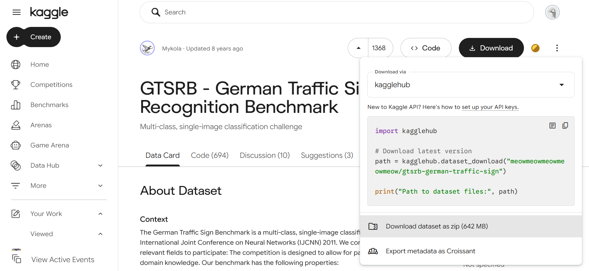

# Instructions
Follow the steps below in order to get the cleaned dataset on your local machine

1. Navigate to the `CompVisCW2` folder in a terminal
2. Create a virtual environment and activate it if not active already:
    1. Run `python -m venv venv`
    2. Activate the new environment with `./venv/Scripts/activate`
        - If this step did not work and it complained about sum unauthorised access ahh, run this then try it again: `Set-ExecutionPolicy -ExecutionPolicy RemoteSigned -Scope CurrentUser`
    3. You should now see your terminal say `(venv)` at the start of new lines.
3. Run the following: `pip install -r requirements.txt`
4. Navigate to the data folder with `cd data`
5. Download the [dataset][data] from Kaggle as a zip alongside the files in this folder. 

6. Should look like this when download complete
7. Once complete, run the following `python prepare.py`

[data]: https://www.kaggle.com/datasets/meowmeowmeowmeowmeow/gtsrb-german-traffic-sign/data